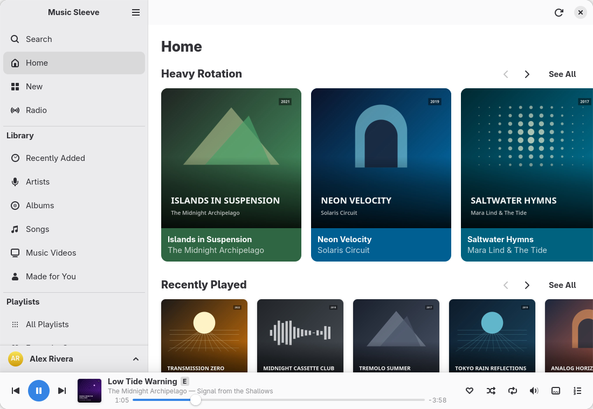
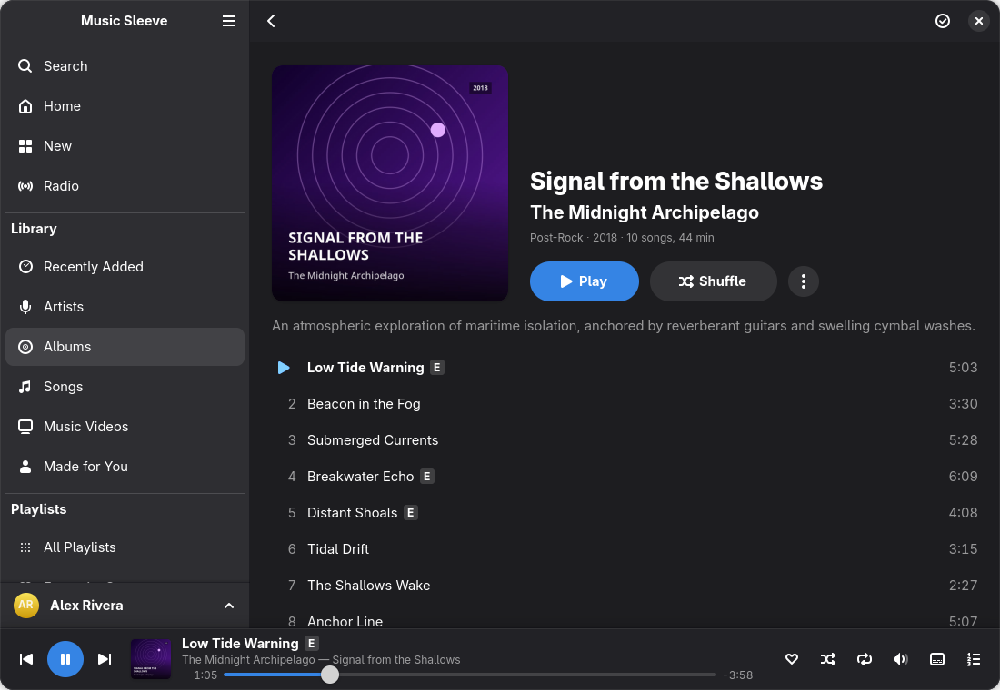
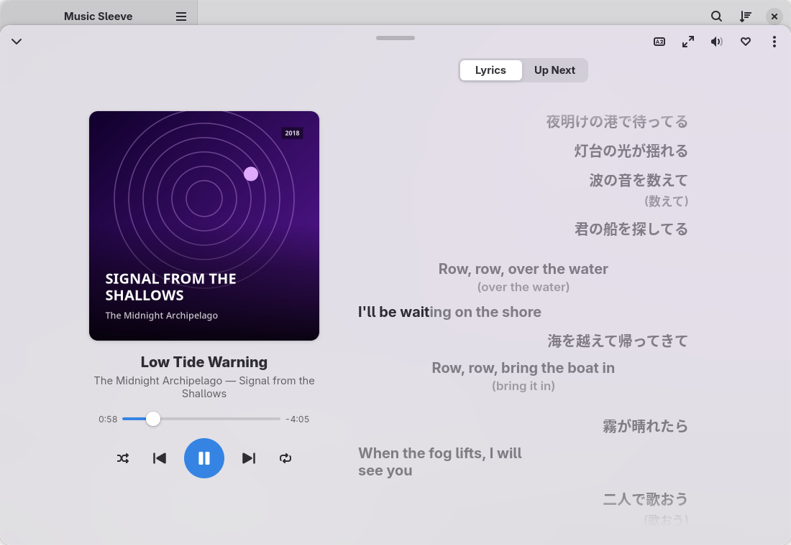

# Music Sleeve

A native GNOME app for Apple Music: your library, playlists, radio and
recommendations, in GTK 4 and libadwaita.

Not affiliated with Apple. Apple Music is a trademark of Apple Inc.



<p align="center">
  
  
</p>

The screenshots show an invented demo library.

> [!IMPORTANT]
> The app plays music through **Google Chrome**, or another Chromium-based browser that
> has Widevine. Apple Music's streams are protected with Widevine DRM, which Google Chrome
> ships and plain Chromium lacks, and Apple offers no public streaming API. The app starts
> Chrome on a private profile, shows music.apple.com in it and drives Apple's own player
> there. Chrome opens a window once, for you to sign in, and runs hidden after that; the
> sound comes out of Chrome, so your system's per-app volume lists it as Chrome.

## What it does

- Your library: Recently Added, Artists, Albums, Songs, Music Videos and Made for You,
  with your playlists and playlist folders in the sidebar. Your favourites carry a heart
  (Favourites Only shows them alone), and the library's lists and a playlist's songs filter
  as you type.
- Home, New, Charts, Radio and Search, with a page for every album and playlist, and artist
  pages laid out as Apple Music's: the artist's wide banner where Apple has one, the latest
  release, top songs, albums, radio shows, About and similar artists. An album's page ends
  with its release date, its other versions, music videos and more by the artist, a
  curator's playlist with its featured artists and more by the curator, linked; Search
  remembers what you opened from it and lists every result with See All.
- Menus on songs, albums, playlists and artists, as each allows: Add to Library or Remove
  from Library, Favourite, Suggest Less, Create Station, and Add to Playlist, for a whole
  album or playlist too.
- Your playlists to manage: make new ones, rename and delete them, add, remove and reorder
  songs, and pick from the songs Apple Music suggests adding; make folders and move
  playlists into them, from a menu or by dragging them onto a folder in the sidebar.
- A player bar (drop songs and playlists on it to queue them; the last song you played is
  there, paused, when the app starts), and a Now Playing view, tinted by the song's artwork,
  with the queue (covers, the History of what played, remove songs from Up Next, clear it,
  and Autoplay's similar songs when it ends) and the lyrics: lit word by word as they are
  sung when Apple Music times them so, with background vocals, duets on two sides, and
  translations and pronunciations when the song has them.
- A full-screen player (<kbd>F11</kbd>): the artwork, the controls and the lyrics over the
  artwork's own colours.
- GNOME's media controls (MPRIS) and the keyboard's media keys.
- Your library in the Activities overview's search: an album, artist, playlist or song
  typed there opens, or plays, from the results.
- If you turn it on in Preferences, what you are listening to shows on your Discord
  profile.
- Light and dark styles; the window adapts down to 360 px wide.

What it does not do: Lossless, Dolby Atmos, an equaliser, crossfade or Sound Check,
offline listening or downloads, Apple Music Sing, and collaborative or smart playlists (it
plays through Apple's web player, which has none of them); music videos with a picture (they
play as audio); moving a playlist out of its folders or a folder into another (Apple's own
apps do those). The whole list, with the reasons, is in the
[user guide](docs/user-guide.md#known-limitations).

## Requirements

- An Apple Music subscription.
- Google Chrome, found as `google-chrome-stable`, `google-chrome` or
  `/opt/google/chrome/chrome`. Without it, the app tries Microsoft Edge, Brave, Vivaldi and
  Chromium (not their snaps), and Preferences › Engine › Browser › Browser program can name
  another command. Any of them plays only with Widevine, which the app checks when the engine
  starts; only Google Chrome is tested.
- GTK 4.20, libadwaita 1.9, GLib 2.84, Python 3.12 and PyGObject 3.50, or newer: the
  libraries of GNOME 50. Any distribution that ships them will do. Fedora 44, Ubuntu 26.04,
  Arch Linux and openSUSE Tumbleweed do; Debian 13 and Ubuntu 24.04 are too old.
- To build it: Meson 1.2, gettext and `blueprint-compiler` 0.22 or newer. When the
  installed `blueprint-compiler` is missing or older (Fedora 44 and Ubuntu 26.04 ship an
  older one), Meson downloads its own during setup.

## Install

There is no distribution package yet. Build from the
[latest release](https://github.com/Jackicus/GNOME-Music-Sleeve/releases/latest)'s
tarball, or from a clone of the repository.

```bash
# The build dependencies, by distribution:
sudo pacman -S --needed gtk4 libadwaita python-gobject meson blueprint-compiler gettext     # Arch
sudo dnf install gtk4-devel libadwaita-devel glib2-devel python3-gobject python3-gobject-devel \
    meson gettext                                                                             # Fedora 44+
sudo apt install libgtk-4-dev libadwaita-1-dev python3-gi python-gi-dev meson gettext        # Ubuntu 26.04

tar xf music-sleeve-1.0.1.tar.xz && cd music-sleeve-1.0.1
meson setup _build --prefix=/usr
meson compile -C _build
sudo meson install -C _build --skip-subprojects
```

To uninstall: `sudo ninja -C _build uninstall`, then `sudo rm -r /usr/share/music-sleeve`
for the byte-compiled modules. On Arch Linux, `build-aux/aur/PKGBUILD` is the AUR package's
source, `music-sleeve`; until it is published there, `makepkg -si` in that directory builds
and installs it. Google Chrome is in the AUR as `google-chrome`.

## First run

1. Start Music Sleeve. The sidebar ends with a **Sign In** button.
2. Click it. A Chrome window opens on music.apple.com: sign in there with your Apple Account,
   as you would in a browser. The app never sees the password.
3. Once you are signed in, the window closes, Chrome carries on hidden and the app syncs your
   library. A banner shows the progress.

From then on the app starts Chrome by itself. <kbd>Ctrl</kbd>+<kbd>?</kbd> lists the keyboard
shortcuts. The [user guide](docs/user-guide.md) covers the rest: refreshing the library,
playing in the background, troubleshooting, privacy, and where your data lives and how to
remove it.

## Contributing

[CONTRIBUTING.md](CONTRIBUTING.md) explains how to build and run the app on an invented
library without Chrome or an account, the conventions, and how to translate it.
[docs/architecture.md](docs/architecture.md) describes how it is put together.

## License

GPL-2.0-or-later. See [LICENSE](LICENSE).
